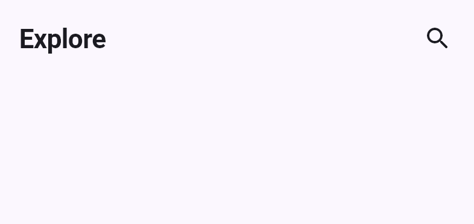
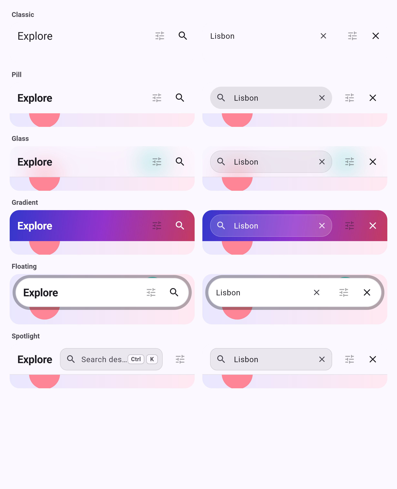
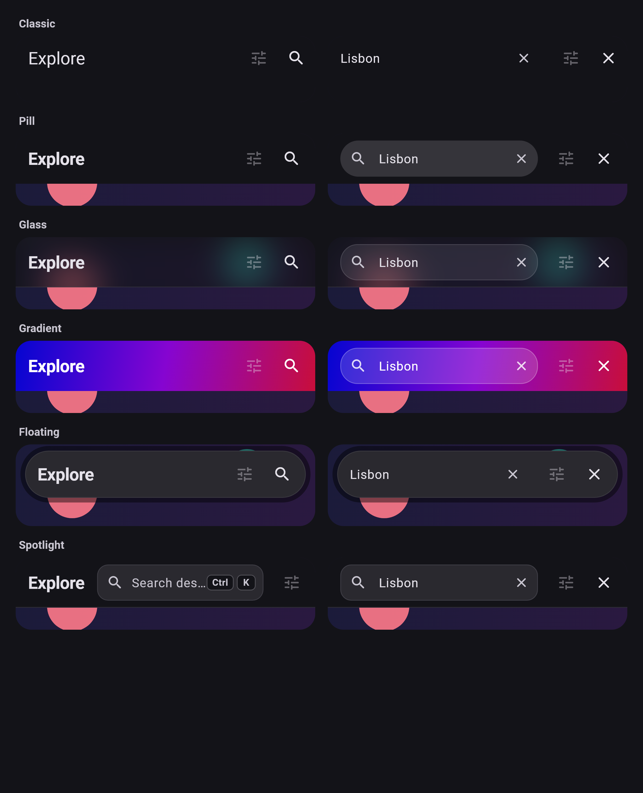
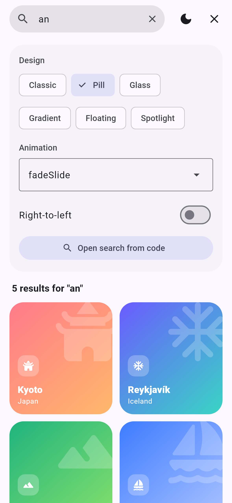
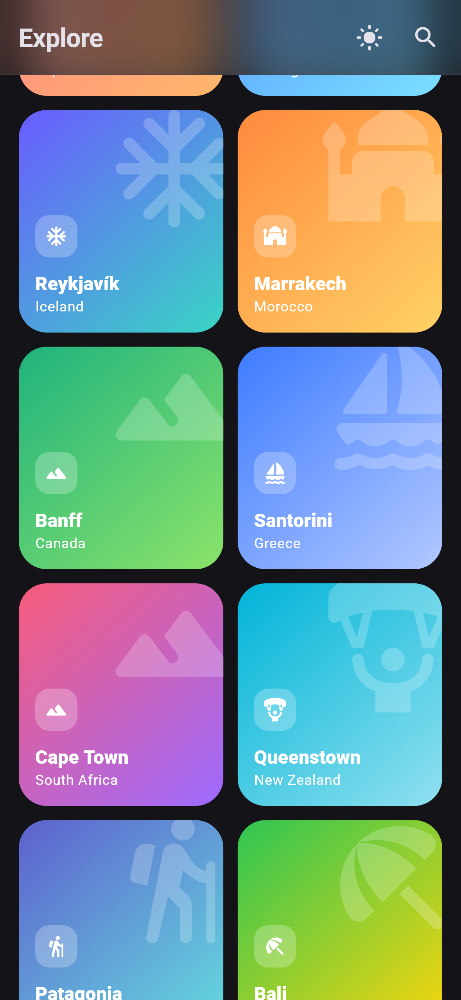
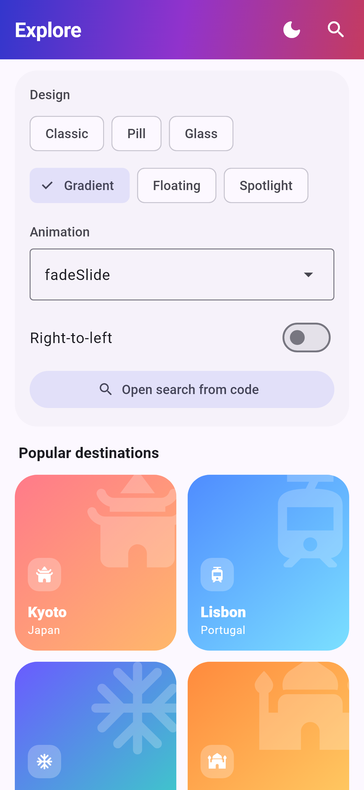
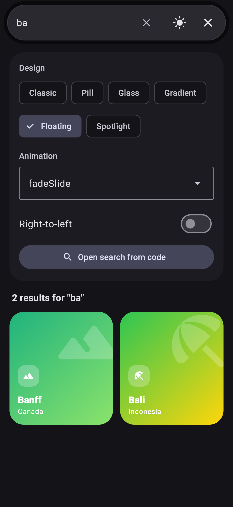
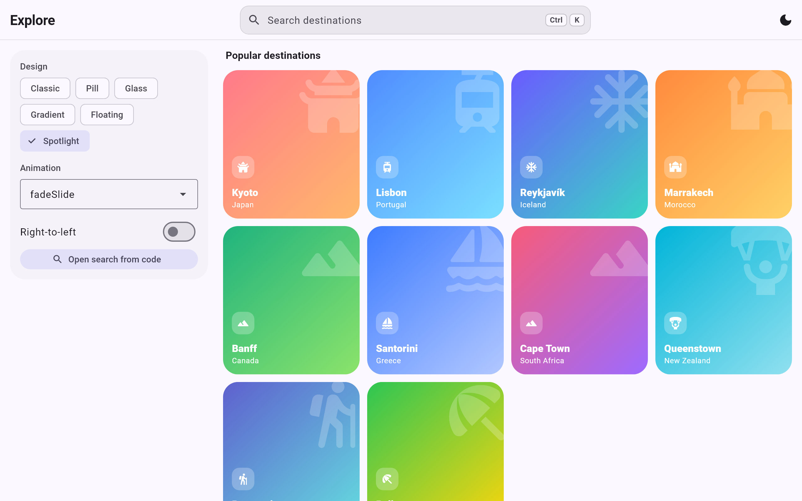

<div align="center">

# app_bar_search

**A beautiful app bar with built-in search for Flutter.**
Six modern designs · ten motion styles · keyboard shortcuts · RTL · responsive · accessible.

[](https://pub.dev/packages/app_bar_search)
[](https://pub.dev/packages/app_bar_search/score)
[](#platforms)
[](LICENSE)



</div>

## Designs

Every design is built from your app's `ColorScheme`, so it matches your brand
in light and dark mode. Left: closed · right: open.

<table>
  <tr>
    <td></td>
    <td></td>
  </tr>
</table>

| Design | Looks like | Great for |
| :-- | :-- | :-- |
| `classic` | A regular Material `AppBar` (the 1.x look) | Drop-in upgrades |
| `pill` | Material 3 search pill: field opens in a rounded, filled capsule | Most apps |
| `glass` | Frosted "liquid glass" that blurs your content underneath | Media, photo & map apps |
| `gradient` | Vivid gradient with on-color text and a translucent field | Brand-forward screens |
| `floating` | Detached capsule with a soft shadow, inset from the edges | Modern consumer apps |
| `spotlight` | Command palette: always-visible search with a ⌘K / Ctrl K hint | Desktop, web, dashboards |

<table>
  <tr>
    <td></td>
    <td></td>
    <td></td>
    <td></td>
  </tr>
</table>



## Install

```yaml
dependencies:
  app_bar_search: ^2.0.1
```

## Quick start

```dart
Scaffold(
  appBar: AppBarSearch(
    title: 'Explore',
    design: AppBarSearchDesign.pill,
    onChanged: (query) => setState(() => _query = query),
  ),
  body: ResultsList(query: _query),
);
```

Closing search clears the text and calls `onChanged('')`, so your filter
resets automatically.

### More options

```dart
final search = AppBarSearchController();

AppBarSearch(
  title: 'Products',
  design: AppBarSearchDesign.gradient,
  animationStyle: SearchAnimationStyle.revealRight,
  gradient: const LinearGradient(colors: [Color(0xFF6A5BFF), Color(0xFFFF6B9A)]),
  hintText: 'Search products',
  debounce: const Duration(milliseconds: 300), // perfect for network search
  searchController: search,                     // search.open() from anywhere
  onSubmitted: runSearch,
  onOpen: () => analytics.log('search_open'),
  actions: [IconButton(icon: const Icon(Icons.tune_rounded), onPressed: showFilters)],
  bottom: const TabBar(tabs: [Tab(text: 'All'), Tab(text: 'Sale')]),
);
```

For `glass` and `floating`, let your content scroll behind the bar:

```dart
Scaffold(extendBodyBehindAppBar: true, appBar: AppBarSearch(title: 'Photos', design: AppBarSearchDesign.glass));
```

## Animation styles

`fadeSlide` (default) · `scale` · `rotate` · `elastic` · `slideRight` ·
`flipVertical` · `revealRight` · `slideUp` · `zoomOut` · `bounce`

All horizontal motion mirrors automatically in right-to-left languages.

## Built for every platform

- **Responsive.** It measures its own width, not the screen's, so split
  views and resizable windows work. From 720 px wide the title stays
  visible and search opens beside it, capped at `maxSearchWidth` (560).
- **Keyboard.** <kbd>⌘</kbd>/<kbd>Ctrl</kbd>+<kbd>K</kbd> and <kbd>/</kbd> open search, <kbd>Esc</kbd> closes it.
  This is on by default for web and desktop, and you can toggle it with `keyboardShortcuts`.
- **Back gesture.** Android back and iOS swipe-back close search before
  leaving the page (`closeOnBack`).
- **Accessible.** The hidden layer is never tappable, focusable or
  announced. The title is a semantic header, and tooltips use Material
  localizations (Search / Close / Clear text in every language). Reduced
  motion is respected.
- **RTL.** Layout and motion follow `Directionality`.

### Platforms

Pure Flutter, with no platform channels: Android, iOS, web, macOS, Windows
and Linux.

## Parameters

| Parameter | Default | Description |
| :-- | :-- | :-- |
| `title` | required | Title text (also used for accessibility) |
| `titleWidget` | `null` | Any widget instead of the title text |
| `design` | `classic` | One of the six `AppBarSearchDesign`s |
| `animationStyle` | `fadeSlide` | One of the ten `SearchAnimationStyle`s |
| `hintText` | localized "Search" | Field placeholder |
| `onChanged` / `onSubmitted` | — | Text callbacks (`onChanged('')` on clear/close) |
| `onClear` / `onOpen` / `onClose` | — | Lifecycle callbacks |
| `debounce` | `null` | Delay before `onChanged`; submit flushes |
| `controller` / `focusNode` | internal | Your own text controller / focus node |
| `searchController` | internal | `AppBarSearchController` to open/close from code |
| `initiallyOpen` | `false` | Start with search open |
| `autoFocus` | `true` | Show the keyboard when search opens |
| `showClearButton` | `true` | Inline × while there is text |
| `keyboardShortcuts` | web/desktop | ⌘/Ctrl+K, `/`, Esc |
| `closeOnBack` | `true` | Back closes search first |
| `leading` / `automaticallyImplyLeading` | implied | Back/drawer button like `AppBar` |
| `actions` | — | Trailing widgets |
| `bottom` | — | e.g. a `TabBar` |
| `backgroundColor` / `foregroundColor` / `iconColor` / `gradient` | from theme | Colors |
| `titleTextStyle` / `searchTextStyle` / `inputDecoration` | from theme | Text & field styling |
| `toolbarHeight` | 56 / 64 | Per design |
| `maxSearchWidth` / `wideBreakpoint` | 560 / 720 | Responsive layout |
| `animationDuration` | 350 ms | Motion speed |
| `searchIcon` / `closeIcon` | rounded icons | Custom icons |
| `searchTooltip` / `closeTooltip` / `clearTooltip` | localized | Tooltip text |

## Example app

[`example/`](example) is a live gallery that lets you switch the design,
animation, theme and RTL, and search a destinations grid. Its layout adapts
from phone to desktop.

```bash
cd example && flutter run -d chrome   # or any device
```

The screenshots are rendered from that app with real fonts:
`flutter test test/screenshots_test.dart --dart-define=CAPTURE=true`.

## Upgrading from 1.x

- `hintText` now defaults to the localized "Search" instead of `'Search...'`.
- Closing search now also calls `onChanged('')` when there was text.
- The hidden title/field layers no longer receive taps, focus or screen-reader
  focus.
- Requires Flutter 3.32 / Dart 3.8 (unchanged from 1.2).

## License

MIT, see [LICENSE](LICENSE).
